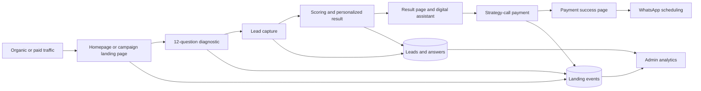
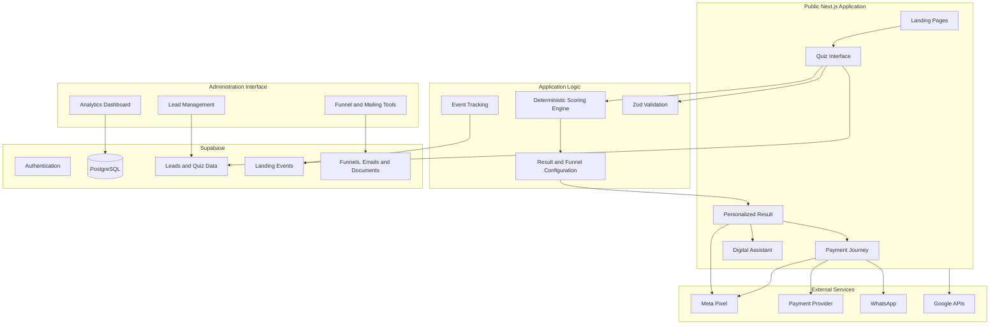

<div align="center">

# Business Operations Diagnostic Platform

### A Hebrew-first diagnostic quiz, personalized result engine and conversion funnel for small-business owners

The platform turns a short operational assessment into a personalized business diagnosis, an actionable result and a measurable path from visitor to paid strategy call.


</div>

## Overview

This project is a full product and acquisition system built for an automation consultancy.

Instead of asking prospects to understand automation terminology or book a generic sales call, the platform helps them recognize the operational problem inside their own business. A visitor completes a focused 12-question diagnostic, receives a personalized business snapshot and is guided toward a paid strategy session when the offer is relevant.

The repository combines several layers that are often built separately:

- conversion-focused landing pages;
- an operational diagnostic and scoring engine;
- personalized result generation;
- lead capture and source attribution;
- payment and scheduling handoff;
- event and advertising tracking;
- an internal CRM-style administration dashboard;
- funnel, email and content-management tooling.

The application itself lives in [`operational-system/`](operational-system/).

## My Role

I designed and developed the platform end to end, combining product strategy, business-process analysis, conversion architecture and full-stack implementation.

My work included:

- defining the diagnostic domains and question structure;
- translating operational pain points into a deterministic scoring model;
- writing the personalized result logic and action-oriented recommendations;
- designing the visitor journey from campaign landing page to payment;
- building the public experience and internal administration system;
- implementing lead, payment and attribution tracking;
- integrating Supabase, advertising pixels, payment handoff and WhatsApp scheduling;
- iterating on copy, interaction design and funnel friction using real tracking behavior.

## Business Problem

Small-business owners often know that their business feels disorganized, but they do not know where the operational leak begins.

The symptoms overlap:

- inquiries arrive but are not followed up consistently;
- repetitive manual tasks consume the working day;
- payment collection depends on memory and uncomfortable reminders;
- information is spread across messages, spreadsheets and disconnected tools;
- the business slows down whenever the owner is unavailable.

A generic “book a call” page asks the prospect to diagnose herself first. This platform reverses that burden: it identifies the dominant operational pattern, explains its cost in plain language and gives the visitor an immediate next step.

## Diagnostic Model

The quiz contains 12 questions organized into four operational domains:

| Domain | What it detects |
|---|---|
| Follow-up | Slow responses, lost inquiries, missing sales follow-up and poor conversion visibility |
| Time | Repetitive manual work, operational interruptions and excessive owner workload |
| Collection | Payment follow-up, unpaid work and manual collection processes |
| Centralization | Scattered information, owner dependency and disconnected business systems |

Each answer contributes severity points to one or more domains. The scoring model also accounts for context such as inquiry volume and the problem the visitor personally experiences as most urgent.

The result is not a generic personality label. It is an operational diagnosis based on the highest-impact business pattern detected in the answers.

## Personalized Result Experience

Each result type contains structured, domain-specific content:

- a direct diagnostic headline;
- an explanation of the current operational pattern;
- the hidden business cost of leaving it unchanged;
- a reframe that separates the owner’s ability from the missing process;
- immediate, weekly and monthly action steps;
- a contextual call to action;
- a pre-filled WhatsApp message relevant to the result.

The result page uses the visitor’s answers to make the diagnosis more specific while preserving deterministic, reviewable business logic.

## Funnel Journey



## Core Capabilities

### Public acquisition experience

- Main website and dedicated paid-campaign landing page
- Mobile-first Hebrew RTL interface
- Campaign-specific CTA identifiers and source attribution
- Reduced-friction quiz flow that begins directly with the first question
- Trust, FAQ, testimonial and objection-handling sections
- Social sharing and WhatsApp preview metadata
- Responsive motion and interaction design with reduced-motion support

### Quiz and result engine

- 12 structured questions across four operational domains
- Weighted domain scoring
- Inquiry-volume amplification without manufacturing a false problem
- Tie-breaking and felt-pain context
- Personalized business snapshot
- Domain-specific action plan and recommendations
- Result-specific WhatsApp and conversion copy

### Lead and conversion funnel

- Lead capture connected to Supabase
- Quiz completion and result-pattern storage
- Paid strategy-call offer
- Payment handoff and success redirect
- WhatsApp scheduling after payment
- Digital assistant context carried into the next-step journey
- Honest expectation-setting around payment, scheduling and deliverables
- Explicit marketing-consent handling

### Tracking and analytics

- Landing-page and quiz event tracking
- Page-view, quiz-start and payment-click events
- Facebook Pixel conversion events such as ViewContent, Lead, Purchase and Schedule
- Production-traffic filtering and duplicate-event protection
- Campaign and source segmentation
- Payment-status breakdown
- Daily lead trends and completed-diagnostic counts

### Internal administration

- Lead-management dashboard
- Recent leads and diagnostic-result visibility
- Payment-status monitoring
- Source-attribution reporting
- Active-funnel overview
- Email activity and document counters
- Meetings requiring follow-up
- Recent cancellation monitoring
- Funnel, mailing and content-management entry points

## Architecture



## Engineering Highlights

### Configuration-driven diagnostic

Questions, scoring weights and result content are separated from the interface. This makes the diagnostic logic easier to review, test and evolve without rewriting the presentation layer.

### Deterministic personalization

The system creates a personalized experience without relying on an opaque model to decide the core result. The dominant diagnosis is computed from explicit scoring rules, while visitor answers are used to enrich the explanation and next steps.

### Conversion instrumentation

The funnel records meaningful steps rather than relying only on page views. Tracking includes quiz engagement, lead submission, payment intent and post-payment events, with source information preserved for campaign analysis.

### In-app-browser reliability

Tracking behavior was hardened for traffic arriving from Instagram, Facebook and other in-app browsers. The implementation favors capturing genuine production traffic while blocking only known local-development hosts.

### Duplicate-event control

Client-side guards reduce duplicate events caused by React development behavior and repeated lifecycle execution. This keeps analytics more useful without silently dropping real campaign traffic.

### Honest funnel design

The interface clearly separates payment from scheduling, keeps marketing consent opt-in, explains the paid deliverable and avoids presenting a payment click as a completed booking.

## Technology Stack

| Area | Technologies |
|---|---|
| Framework | Next.js 14, React 18, TypeScript |
| UI | Tailwind CSS, Radix UI, Framer Motion, Lucide React |
| Data and auth | Supabase, PostgreSQL, Supabase SSR |
| State and validation | Zustand, Zod |
| Analytics | Recharts, custom landing-event tracking, Meta Pixel |
| Integrations | Payment handoff, WhatsApp, Google APIs |
| Content tools | React Email Editor, structured funnel and result configuration |
| Security and rendering | DOMPurify, server/client separation, Next.js metadata |
| Deployment | Vercel-compatible Next.js application |

## Repository Structure

```text
Operational-Personality-Questionnaire/
├── README.md
└── operational-system/
    ├── src/
    │   ├── app/             # Public pages, quiz, result, payment and admin routes
    │   ├── components/      # Quiz, funnel, admin and shared UI components
    │   ├── config/          # Questions, result content and funnel copy
    │   └── lib/             # Scoring, Supabase, tracking and business logic
    ├── supabase/            # Database migrations and platform configuration
    ├── public/              # Images and social-sharing assets
    └── package.json
```

## Local Development

### Prerequisites

- Node.js 18 or later
- npm
- A Supabase project for data-backed flows
- Optional external-service configuration for payment, analytics and scheduling integrations

### Setup

```bash
git clone https://github.com/HadarguetaTur/Operational-Personality-Questionnaire.git
cd Operational-Personality-Questionnaire/operational-system
npm install
npm run dev
```

Open `http://localhost:3000` in your browser.

Environment variables are required for Supabase and any enabled integrations. Real credentials should remain outside source control.

### Available scripts

```bash
npm run dev     # Start the development server
npm run build   # Create a production build
npm run start   # Start the production server
npm run lint    # Run Next.js linting
```

## Project Status

The platform is an actively developed product and portfolio case study. It demonstrates a complete diagnostic and acquisition journey, but this repository does not claim a specific number of users, paid conversions or commercial results.

## What This Project Demonstrates

This project demonstrates my ability to:

- translate an unclear business problem into a structured digital product;
- build deterministic diagnostic and personalization logic;
- connect product experience with an actual sales funnel;
- design both customer-facing and internal operational interfaces;
- instrument conversion events and debug attribution failures;
- integrate data, payment, advertising and messaging systems;
- improve copy and UX without separating them from engineering decisions;
- carry a prospect from first click to a measurable business action.

## Author

**Hadar Gueta**  
Automation & AI Solutions Engineer

- GitHub: [@HadarguetaTur](https://github.com/HadarguetaTur)
- Email: [hadart20@gmail.com](mailto:hadart20@gmail.com)

---

Copyright © 2026 Hadar Gueta. All rights reserved. This repository is shared for portfolio and evaluation purposes; no license is granted for commercial reuse.
